# Laboratory Exercise 6 — Real-Time Inventory Tracking System

**Course / Subject:** MVC Architecture with Laravel  
**Student ID:** 2411600148  
**Student Name:** _(replace with your last name before submitting)_  
**Project:** JimTrack Fitness / PulseTrack Inventory System  
**Repository folder:** `lab6_2411600148`

---

## 1. Objective

This laboratory extends the Laboratory Exercise 5 inventory system with real-time stock
tracking. Every stock movement is now recorded as an `InventoryTransaction`, applied to the
product quantity automatically through an Eloquent observer, protected by database
transactions, audited with the user who performed it, and surfaced on the dashboard through
a small JSON API with 30-second AJAX polling. Existing Lab 5 data is preserved with
incremental, guarded migrations.

---

## 2. Implementation summary (Parts 1–11)

| Part | What was implemented |
|------|----------------------|
| **1. Transaction model** | `InventoryTransaction` with `product()` and `user()` belongs-to relations, `TYPE_IN` / `TYPE_OUT` / `TYPE_ADJUSTMENT` constants, `direction`, `quantity`, `reference_number`, `notes`, `balance_after`, `is_reversed`, timestamps, indexes and scopes (`stockIn`, `stockOut`, `adjustments`, `notReversed`, `recent`, `forProduct`, `betweenDates`). The Lab 5 `reference` attribute is kept as an accessor/mutator for compatibility. |
| **2. Eloquent observer** | `InventoryTransactionObserver::created()` locks the product row with `lockForUpdate()`, calculates the signed delta, rejects a negative resulting balance, updates `products.quantity` with `updateQuietly()`, stores `balance_after`, and triggers the low-stock alert. The observer is the **single source of truth** for quantity changes. |
| **3. Transaction controller** | `InventoryTransactionController` with `index` (pagination, eager loading, filters), `create`, `store` (validation + `DB::transaction()`), `show` (running balance), and admin-only `destroy` (reversal, not deletion). |
| **4. Product model** | Added `latestTransaction()`, `isLowStock()`, `isOutOfStock()`, `getStockStatusAttribute()`, `getStockStatusColorAttribute()`, `scopeLowStock()`, `scopeOutOfStock()`, `scopeInCategory()` plus the low-stock notification timestamp cast. |
| **5. Views and layout** | Transactions index/create/show, notification bell and dropdown, user dropdown, sidebar links, and Lab 6 styles in `public/css/jimtrack.css` using the existing PulseTrack palette. |
| **6. Low-stock notifications** | `LowStockNotification` implements `ShouldQueue` and sends `database` + `mail` channels to active admins. `products.low_stock_notified_at` deduplicates alerts until the product is replenished above its reorder level. Inbox supports mark-as-read and mark-all-as-read. |
| **7. Real-time dashboard** | API endpoints `/api/dashboard/stats`, `/api/products/low-stock`, `/api/transactions/recent`, `/api/products/{product}/stock`, formatted with API Resources. `public/js/inventory-live.js` polls every 30 seconds, animates changed numbers, updates the "Last Updated" label, refreshes on tab focus, and handles failures gracefully. |
| **8. Stock adjustments** | Admin-only physical-count form. The controller calculates `physical − system`, creates an adjustment transaction with the correct direction, logs the change, and lets the observer apply it. The form loads the current stock over AJAX. |
| **9. History and reports** | Product detail now shows a date-filtered transaction table with a running balance. `/reports/tracking` produces a stock movement report, low-stock report and inventory valuation report, with CSV export. |
| **10. Testing** | `php artisan test` — **64 tests pass**, including observer stock in/out, oversell rollback, validation, alert dedupe, adjustment direction, reversal/audit retention, role restrictions, API payloads, page rendering, order/stockout/SKU/role-report tests, the exact sidebar groups, receipt generation and profile editing. Browser verification confirmed all Lab 6 pages load with no console errors and the three API calls return HTTP 200. |
| **11. GitHub readiness** | `.gitignore` excludes `.env`, compiled dependencies and generated caches. Git initialization and the first commit are prepared locally (see `COMMIT_NOTES.md`); push requires the repository remote URL. |

### Key design decisions

- **Observer instead of a raw database trigger.** The lab lists Eloquent events/observers as the Laravel implementation for automatic stock updates. An observer keeps the logic testable, portable between MySQL and SQLite, and inside Laravel's DB transaction.
- **Option A for overselling: throw and roll back.** A stock-out that would make the balance negative throws `InsufficientStockException`. Because it is thrown inside `DB::transaction()`, both the transaction row and the product update are rolled back. Capping at zero would hide a real data error; allowing negatives would make valuation and reorder alerts meaningless.
- **Reversal instead of deletion.** `destroy()` creates an equal-and-opposite transaction and flags the original `is_reversed = true`, so the audit trail is never destroyed.
- **Incremental migrations.** Lab 5 rows and quantities are retained. Each new migration checks for existing columns/indexes before changing the schema.

### Follow-up enhancements requested after the first demo

- **Admin login.** The protected admin account now uses `jimpadillo@gmail.com` / `admin123`.
  The credentials are printed at the bottom of the login form. Migration
  `2026_11_22_000007_update_admin_credentials.php` updates the existing Lab 5 user row in
  place, so no account history is lost. The old `ADMIN` shortcut still resolves to the same
  protected account.
- **Role-specific dashboard.** Admin dashboard panels: Sales Report, Purchase Report,
  Product Report, Daily Report History, Product History and a pending-order review banner.
  Staff dashboard panels: Product Report, My Orders and a profile shortcut.
- **Order approval workflow.** Staff submit purchase/sales orders with status `Pending`; no
  stock changes yet. An admin edits the submitted quantity (the original is preserved in
  `original_quantity`), then approves. Only approval creates an `InventoryTransaction`, so
  the observer updates stock, alerts and the audit trail from the corrected figure. Staff
  cannot edit or approve orders.
- **Order date rule.** `ValidOrderDate` rejects past dates such as yesterday and accepts
  today or any future date. The form also sets `min` to today.
- **Product ID / SKU.** Now accepts alphanumeric values such as `JT-001` or `ABC123`
  (letters, numbers, dots, hyphens, underscores) and validates them on the server.
- **Automatic unavailability and stockout alert.** When an outbound movement takes a
  product to exactly zero, the observer sets `is_active = false` so the product shows as
  **Unavailable** in Products and Inventory (which also filter by brand, category and
  status). Active admins receive a `StockOutNotification` in the bell dropdown and by email,
  and an Inventory activity-log entry records the event. A later stock-in restores the
  product automatically.
- **Exact sidebar menu.** The navigation now uses the requested groups — MAIN (Dashboard),
  INVENTORY (Inventory, Products, Brands, Categories), MANAGEMENT (Users, Product Report),
  ORDERS (Sales Order, Purchase Order), RECORDS (Receipt, Transaction History) and MONITORING
  (Product History, Daily Report History, Audit Trail). Staff see the subset shown in the
  portal screenshot: Products/Brands/Categories, Product Report, both order pages,
  Transaction History, Product History and Audit Trail. My Profile is available from the
  user dropdown.
- **Receipts.** Approving an order assigns a unique `RCP-YYYY-####` number. The Receipt page
  lists them and each receipt is printable with product, quantity, price, total and signature
  lines. Staff can print only their own receipts.
- **Profile editing.** Users can update their name, email and profile picture (JPG/PNG/GIF/WEBP,
  max 2 MB) and change their password after entering the current one. The protected admin
  email is read-only and enforced server-side.
- **dbGate access.** `DBGATE.md` documents the live MySQL connection
  (`127.0.0.1:3306`, `jimtrack_inventory`, `root`, blank password), verification queries and
  optional SQL backup/import steps.

---

## 3. Screenshots

Login page:

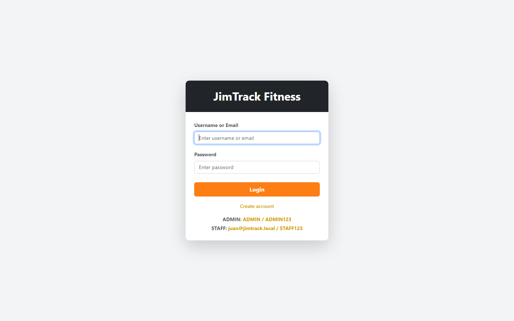

Dashboard with live statistics and "Last Updated" timestamp:

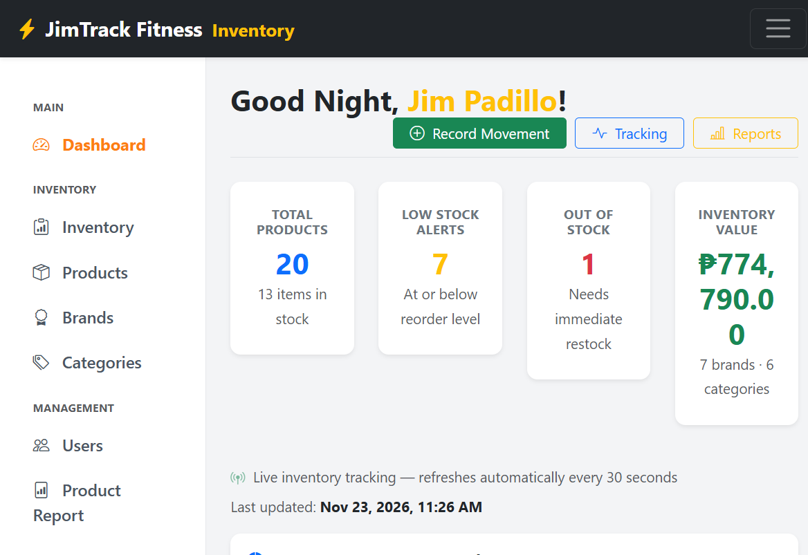

Product index:

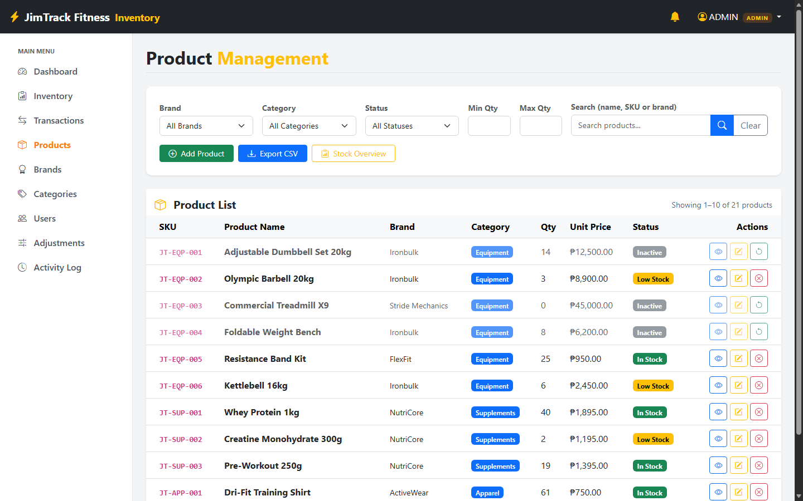

Add product form:

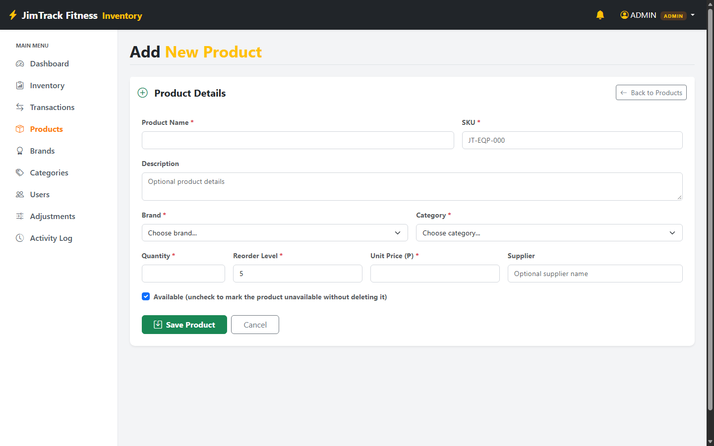

Product edit page:

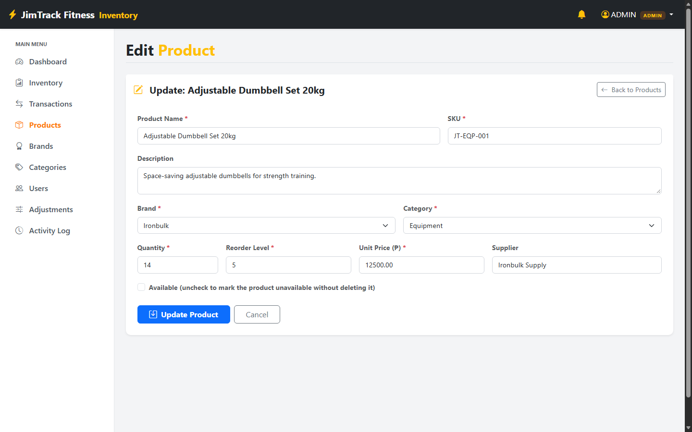

Transaction log:

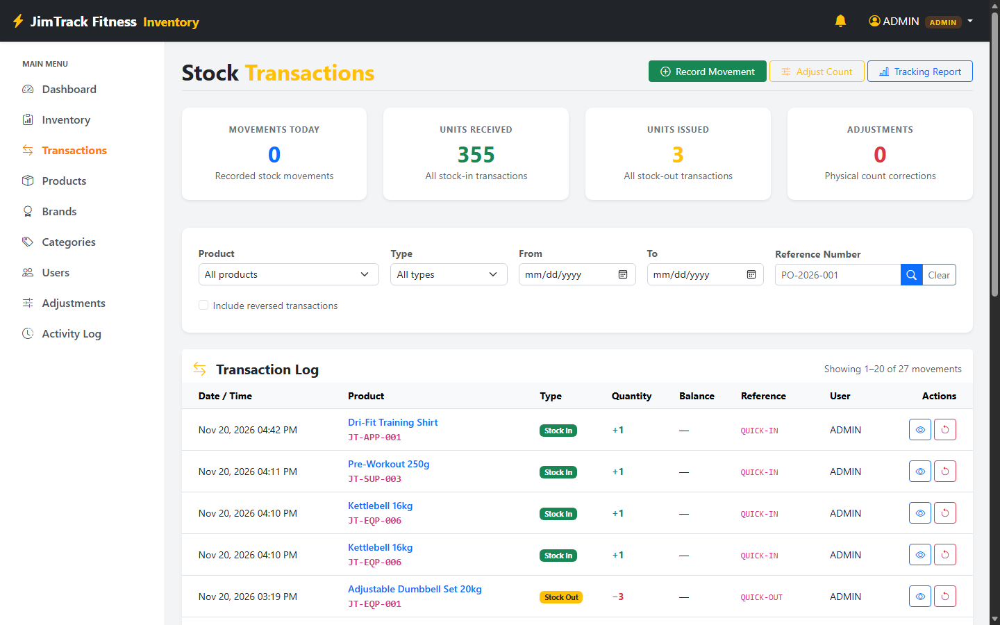

Record movement form with live stock preview:

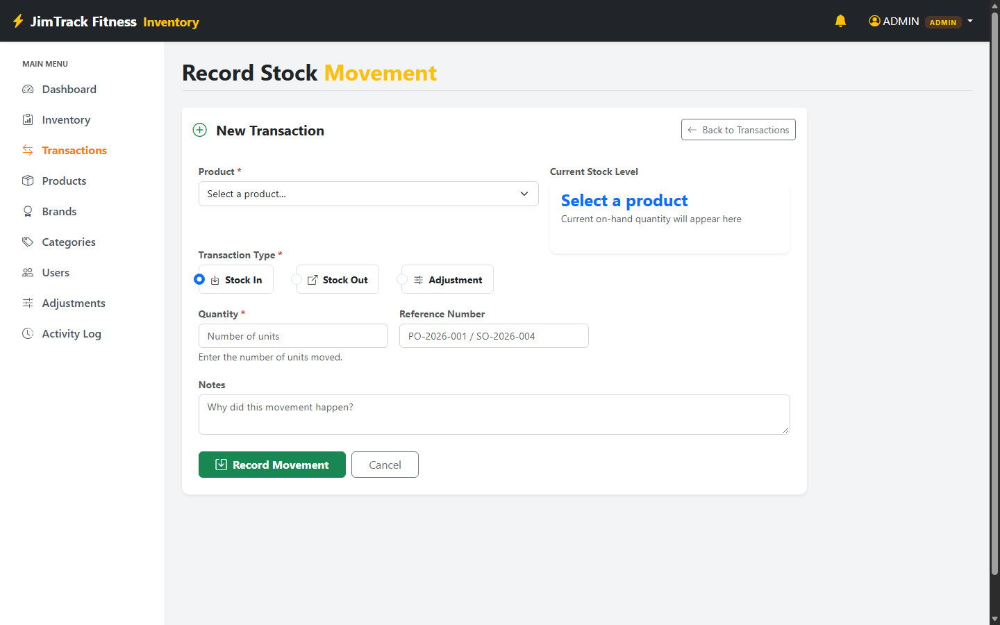

Product transaction history with running balance and date filter:

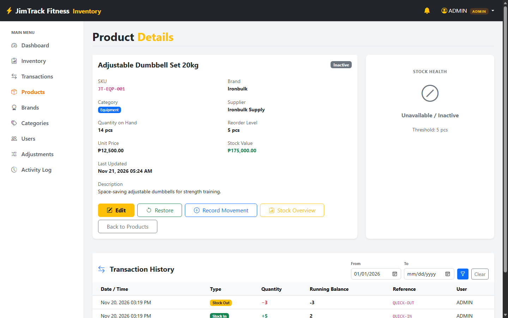

Physical-count adjustment form:

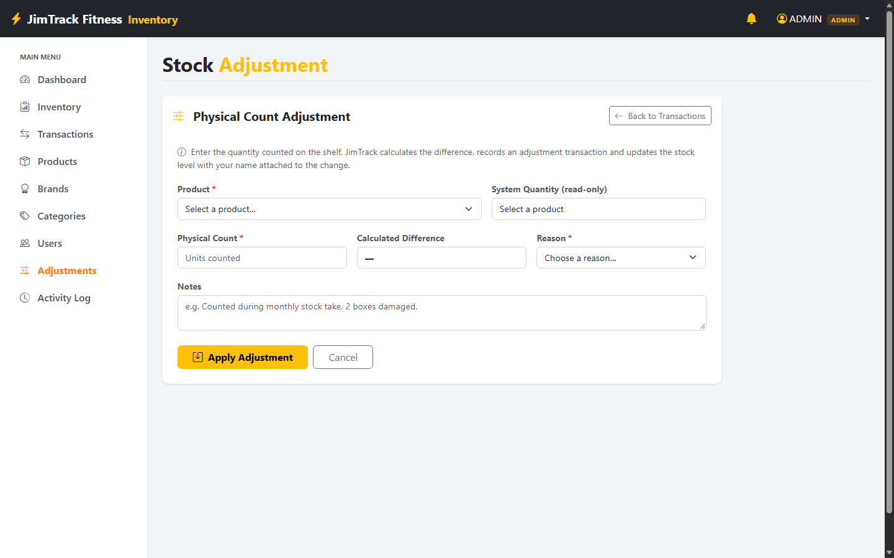

Low-stock notification inbox:

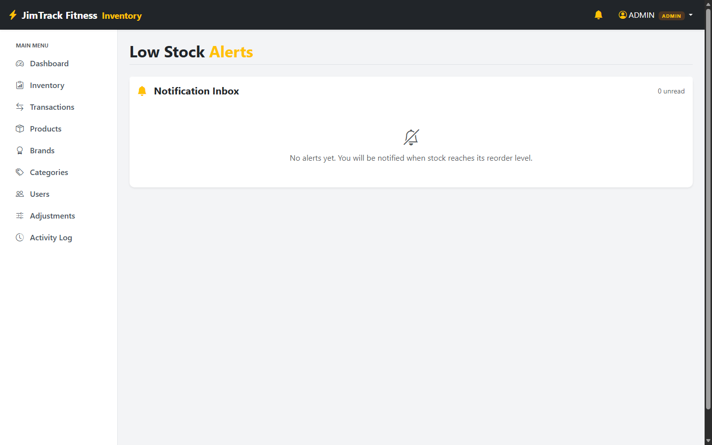

Tracking report:

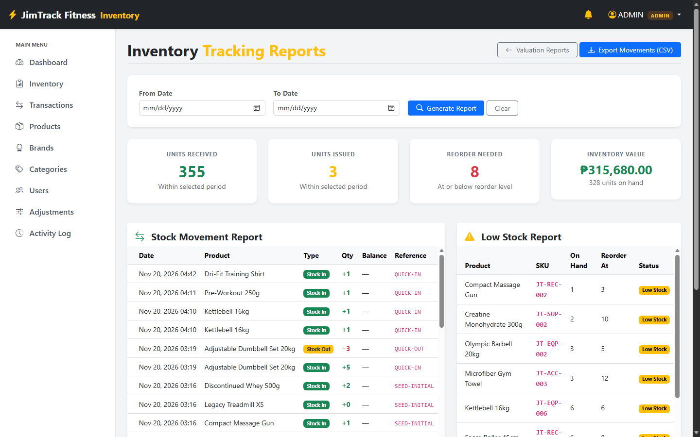

> Additional instructor-requested captures (VS Code source files, phpMyAdmin products table,
> GitHub repository page, terminal output) can be added from your own environment before
> exporting this report to PDF. The application screenshots above were captured from the
> running project at `http://127.0.0.1:8000`.

---

## 4. Questions

### 4.1 If updating the product quantity fails after the transaction was created, how would you handle it? How does Laravel's database transaction feature help?

I would not try to "fix" the product row afterwards. The transaction record and the product
quantity update are one logical unit of work, so they must either both succeed or both fail.
In this project the controller calls `DB::transaction(fn () => InventoryTransaction::create($data))`.
The observer's `created()` event runs inside that same transaction and updates the product.
If the product update throws — for example because the new quantity would be negative — the
observer throws `InsufficientStockException`. Laravel catches the exception inside
`DB::transaction()`, rolls back every statement executed in the closure, and then rethrows
the exception so the controller can show a friendly validation error. The result is that no
orphan transaction row is left behind and the product quantity never disagrees with the
audit log. `lockForUpdate()` also protects the check against concurrent requests: two
simultaneous stock-outs cannot both read the same old quantity and oversell.

### 4.2 What happens if an exception is thrown inside a `DB::transaction()` closure? How does Laravel handle rollback?

Laravel begins a database transaction, executes the closure, and commits only if the closure
finishes normally. If any `Throwable` is thrown, Laravel rolls back the transaction and then
rethrows the exception to the caller. It is important not to catch the exception inside the
closure without rethrowing it, because that would make Laravel commit partial work. In this
system the controller catches `InsufficientStockException` **outside** the closure and
returns the user to the form with an error message. The observer itself contains no catch
around the stock check, so the rollback always happens. Notification delivery is the only
deliberately tolerated failure: it is wrapped in `try/catch` and reported, because an email
problem should not undo a valid stock movement.

### 4.3 Compare AJAX polling with WebSockets for real-time updates. What are the trade-offs?

AJAX polling makes regular HTTP requests (every 30 seconds here) to a JSON endpoint and
replaces parts of the DOM with the response. It is simple to build, works with ordinary
shared hosting and existing session authentication, needs no extra service, and degrades
gracefully if a request fails. Its drawbacks are extra requests even when nothing changed,
up to 30 seconds of latency, and more server work as the number of users grows. WebSockets
keep one persistent, bidirectional connection open and let the server push changes instantly.
They are more efficient and truly real-time, but require a WebSocket server such as Laravel
Reverb/Soketi, broadcasting configuration, connection scaling, and more operational
complexity. For a laboratory demonstration of stock tracking, polling is the appropriate
trade-off: it proves the same data flow with far less infrastructure. If the system later
needs sub-second updates for many simultaneous users, the API payloads are already separated
into Resources and could be reused with broadcasting events.

---

## 5. Conclusion

Laboratory Exercise 6 showed how an existing MVC application can evolve from simple product
CRUD into an event-driven, auditable inventory system without discarding earlier work. The
most important lesson was separating responsibilities: controllers validate input and create
a transaction record, while an observer owns the actual stock mutation. That single rule
made the system much easier to reason about, because every quantity change has a matching
movement row with a product, a user, a timestamp and a running balance. Wrapping the write in
`DB::transaction()` and locking the product row taught the practical value of atomicity and
concurrency control: an oversell is rejected cleanly instead of producing negative inventory
or a mismatched audit trail. I also learned how Laravel notifications and queues work
together — the observer only decides that an alert is needed, while the queued notification
handles database and email delivery, and a timestamp on the product prevents duplicate
alerts during the same low-stock episode. On the client side, API Resources gave the
dashboard a stable JSON contract, and a small polling script kept the KPIs, low-stock list
and recent movements current without a page reload. Finally, implementing reversals rather
than deletions reinforced that inventory history is evidence: corrections must be recorded
as new movements, not hidden. The incremental migrations were equally valuable because they
demonstrated how to extend a live database safely. Overall, this exercise connected Laravel
concepts — observers, policies, transactions, queues, notifications, API resources and
Blade — into one coherent business process, and it made the importance of data integrity and
user accountability in inventory tracking very clear.

*(Word count: 263)*

---

## 6. Verification commands

```bash
php artisan migrate --no-interaction   # incremental, keeps Lab 5 data
php artisan test                       # 64 tests pass
php artisan route:list --path=api      # 4 JSON endpoints
php artisan serve                      # http://127.0.0.1:8000
php artisan queue:work                 # deliver queued low-stock emails
```
